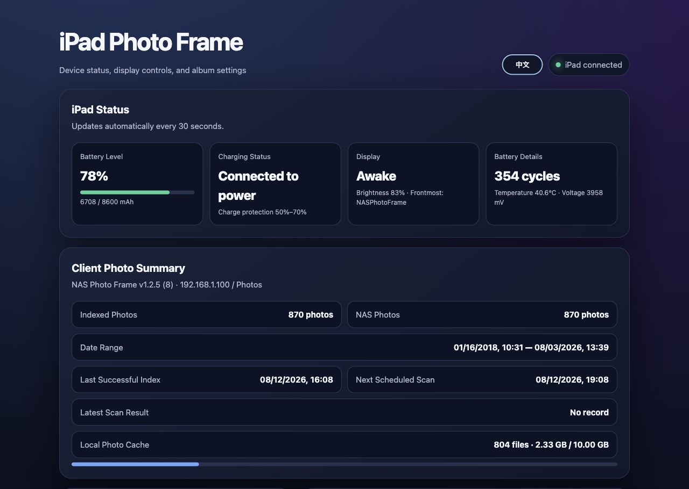
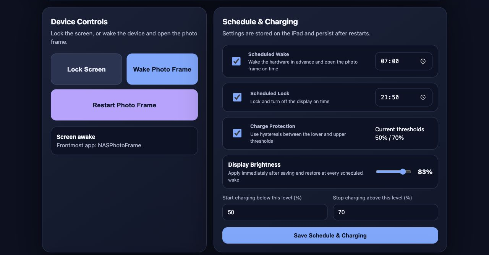
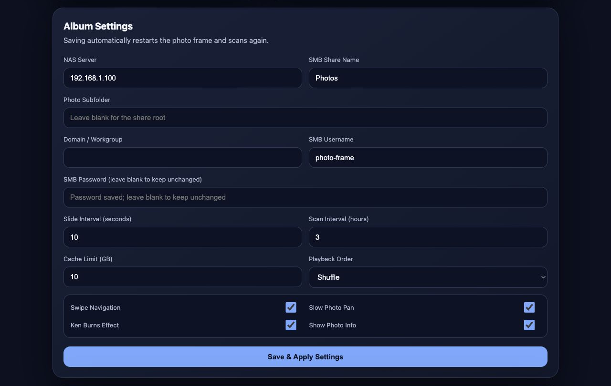

[简体中文](README.md) | [English](README.en.md)

# NAS Photo Frame

Turn an old jailbroken iPad into a NAS-powered digital photo frame designed for continuous operation.

NAS Photo Frame is a full-screen photo player for the iPad 4 running iOS 8. It reads SMB2/SMB3 images directly from a NAS through the bundled `libsmb2`, with offline caching, photo indexing, memory-efficient decoding, scheduled screen sleep/wake, charge protection, and an optional LAN management page.

> This is an experimental project for old jailbroken devices. It uses root daemons and private iOS APIs. Use it only on devices that you own and can restore, and never expose an old iOS device or the management page to the public internet.

## Screenshots







## Features

- SMB2/SMB3 + NTLMSSP access to a NAS, with no need to enable SMB1
- Recursive scanning of JPG, JPEG, PNG, GIF, BMP, and TIFF files into a local SQLite index
- Sequential or shuffled playback, crossfades, panning, and an optional Ken Burns effect
- EXIF/IPTC date and GPS location display, with an offline GeoNames city fallback
- Original-image disk cache, LRU cleanup, network-failure circuit breaker, and continued offline playback
- Background ImageIO downsampling for the iPad 4's 1 GB of memory
- SMB passwords stored in Keychain and ordinary settings stored in `NSUserDefaults`
- Optional charge-protection daemon with hysteresis thresholds to reduce battery stress during long-term plugged-in use
- Optional scheduled locking, waking, unlocking, and automatic photo-frame launch
- Optional Docker-based management page for the local network

## Requirements

- A jailbroken iPad, preferably an iPad 4 running iOS 8.4.1
- A macOS build machine
- Theos
- An original iPhoneOS 8.4 SDK from Apple's official Xcode 6.4 release
- A NAS that supports SMB2/SMB3

This repository does not include Theos, Apple SDKs, Xcode disk images, build artifacts, or signing material. Apple SDKs are governed by their license terms. Obtain them yourself from Apple Developer Downloads and do not upload them to this repository.

## Getting and Building

```sh
git clone https://github.com/nani-kun/NASPhotoFrame.git
cd NASPhotoFrame
export THEOS=/path/to/theos
make clean package
```

The project targets `armv7`, uses the iPhoneOS 8.4 SDK, and supports iOS 8.0 or later. See the [build guide](docs/BUILDING.en.md) for complete environment setup, SDK placement, installation, and troubleshooting instructions.

## Usage

1. Create a dedicated read-only NAS account whose access is limited to the photo directory.
2. Enable SMB2 or SMB3. Do not enable SMB1 for this project.
3. Install the generated `.deb`, then open “NAS Photo Frame” from the Home Screen.
4. Enter the NAS address, share name, relative directory within the share, username, and password.
5. Test the connection, save the configuration, and wait for the initial index to finish.

Use a fixed private IPv4 address for the NAS when possible. Enter only the share name, such as `Photos`, without an `smb://` prefix. Enter the directory as a path relative to the share, such as `Family/Album`.

## Repository Layout

```text
Sources/          iPad application source
ChargeLimiter/    Charge-protection daemon
DisplayScheduler/ Screen sleep, wake, and brightness scheduling daemon
RemoteControl/    Command-line bridge used by the LAN management service
Resources/        Icons, Info.plist, and the offline GeoNames database
layout/           Debian package lifecycle scripts and launchd configuration
nas-manager/      Optional Docker-based LAN management page
scripts/          Data-generation helper scripts
ThirdParty/       Bundled third-party components and their licenses
docs/             Architecture, build, management-service, and release docs
```

See the [architecture overview](docs/ARCHITECTURE.en.md) for details about threading, caching, and failure handling.

## NAS Management Page (Optional)

The management page invokes `PFDisplayScheduler`, `PFChargeLimiter`, and `PFRemoteControl` on the device over SSH. It uses HTTP Basic Authentication and does not provide TLS by default, so it is intended only for trusted local networks. See the [NAS management service guide](docs/NAS_MANAGER.en.md) for configuration and initial authorization.

## Security Notes

- Never expose old iOS, device SSH, or the management page to the public internet.
- Put the iPad on an isolated home LAN/VLAN when possible, allowing access only to the NAS and management host.
- Create a dedicated read-only account for the photo share instead of reusing a NAS administrator account.
- Use an SSH key, change the default root password, and restrict which source addresses can reach the device.
- Report security issues privately according to the [security policy](SECURITY.en.md). Do not disclose credentials or vulnerability details publicly.

## Contributing

Issues and pull requests are welcome. Read the [contributing guide](CONTRIBUTING.en.md) before getting started. Maintainers can use the [release checklist](docs/RELEASING.en.md) to verify versions, licenses, sensitive information, and build artifacts.

## License

Project-authored code is available under the [MIT License](LICENSE). `ThirdParty/libsmb2` is licensed under LGPL-2.1, and GeoNames-derived data is licensed under CC BY 4.0. See the [third-party notices](THIRD_PARTY_NOTICES.en.md) for attribution and local modifications. All third-party components remain subject to their respective licenses.
